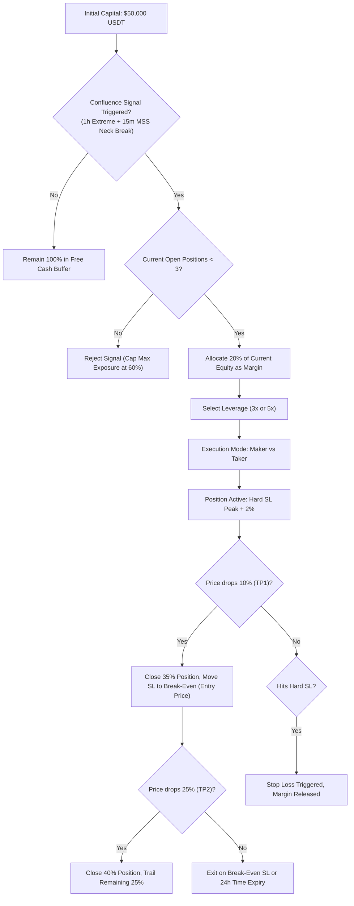

# Implementation Plan: $50,000 USDT All-Satellite Aggressive Compounding Backtest
# 执行计划：5万美金本金“全卫星”激进复利多周期协同回测系统

---

## 1. Goal Description & Strategic Context / 目标说明与战略定位

### English
The user has decided to allocate their entire **$50,000 USDT** account into **"Path 3: All-Satellite Mode" (全卫星模式)**. 
- **The Core Problem with Conservative Allocation for $50k Accounts**: In traditional Core-Satellite structures, 70% of capital is locked in delta-neutral cash-and-carry or passive holding earning ~5–8% APR, which yields only $2,500–$4,000/year on a $50k account. For an investor seeking meaningful wealth accumulation, this capital efficiency is insufficient.
- **The All-Satellite Solution**: 100% of the $50,000 capital is designated as an active tactical weapon, hunting high-conviction **Multi-Timeframe Funding Climax Reversals (1h + 15m + 1m)** across 2023–2026.
- **Core Objectives**:
  1. Initialize portfolio equity at **$50,000.00 USDT**.
  2. Implement strict portfolio-level risk controls: **20% equity margin per trade**, maximum **3 concurrent positions**, ensuring at least **40% free cash reserve** to eliminate margin call risks.
  3. Support dynamic compounding: as the account grows, position size scales proportionally.
  4. Perform head-to-head empirical comparisons:
     - **3x Leverage vs. 5x Leverage**
     - **Maker Execution (0.02% fee, 0.00% slippage) vs. Taker Execution (0.05% fee, 0.20% slippage)**
  5. Deliver full trade audits, equity growth curves, win rates, drawdowns, and dollar PnL.

---

### 中文
用户决定将其全部 **50,000 USDT** 账户资产直接投入**“路径3：全卫星策略模式（All-Satellite Mode）”**：
- **5万美金小体量账户的痛点**：在传统“母基金 70% + 卫星 30%”结构中，70% 资金（3.5 万 USDT）沉淀在年化仅 5%~8% 的期现套利中，一年收益仅 2,000~3,000 美金，资金周转效率与增值速度严重不足；
- **全卫星战法破局**：将全部 5 万美金作为机动进攻部队，专打高盈亏比的**多周期协同极值轧空见顶反转（1h 宏观 + 15m 颈线破位 + 1m 微观狙击）**；
- **核心实测目标**：
  1. 初始本金精确设定为 **$50,000.00 USDT**；
  2. 实施账户级风控锁扣：**单笔使用 20% 账户净值作为保证金**，全账户**最多同时并发 3 笔持仓**，账户内永久保留 **至少 40% 纯现金缓冲池**，杜绝连环爆仓风险；
  3. 支持真实动态复利：随着胜率变现和账户净值增长，单笔头寸规模按比例动态递增；
  4. 开展全量四维正面对比：
     - **3 倍杠杆 vs 5 倍杠杆**
     - **Maker 限价挂单（0.02% 费率, 0 滑点）vs Taker 市价吃单（0.05% 费率, 0.20% 滑点）**
  5. 输出完整逐笔审计日志、5万美金真实净值演化曲线、胜率、盈亏比与美元绝对回报。

---

## 2. Risk Management & Execution Architecture / 风险控制与执行架构

---

## 3. Implementation Steps & Scripts / 实施步骤与核心脚本

### Component 1: Engine Implementation (`scripts/backtest_all_satellite_50k.py`)
- Load all 108 synchronized multi-timeframe episodes (2023–2026).
- Sort episodes by exact chronological start time.
- Simulate exact temporal order of fills, concurrent active positions, margin locks, and capital compounding from $50,000.
- Compare:
  1. **50k 3x Maker**
  2. **50k 5x Maker**
  3. **50k 3x Taker**
  4. **50k 5x Taker**

### Component 2: Visualization & Reporting
- Generate comparison table with Initial Capital ($50k), Final Capital, Net Profit ($), Total Return (%), Win Rate (%), Profit Factor, Max Drawdown (%), and Total Traded Volume.
- Export detailed trade logs to `reports/backtest_satellite_50k_trades.csv`.
- Plot high-resolution equity curves starting from $50,000 saved to `reports/backtest_satellite_50k_equity_curve.png`.
- Update `walkthrough.md` with bilingual analysis.

---

## 4. Verification Plan / 验证方案

1. Run `python scripts/backtest_all_satellite_50k.py`.
2. Verify that no position ever exceeds the 3-concurrent limit and no trade exceeds the margin limit.
3. Verify that fees and slippages are realistically deducted.
4. Verify that the equity curves and CSV trade logs are successfully exported.
